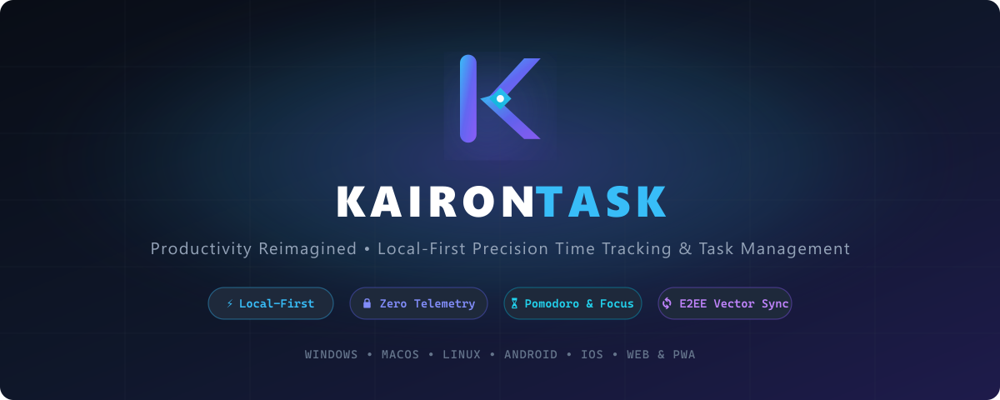
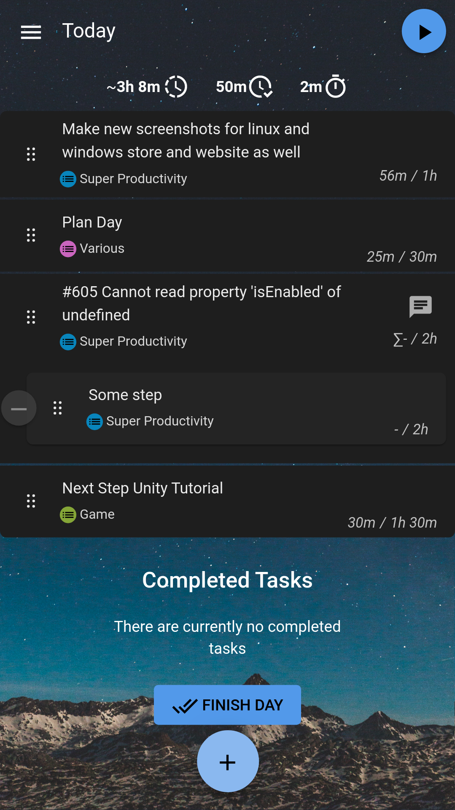
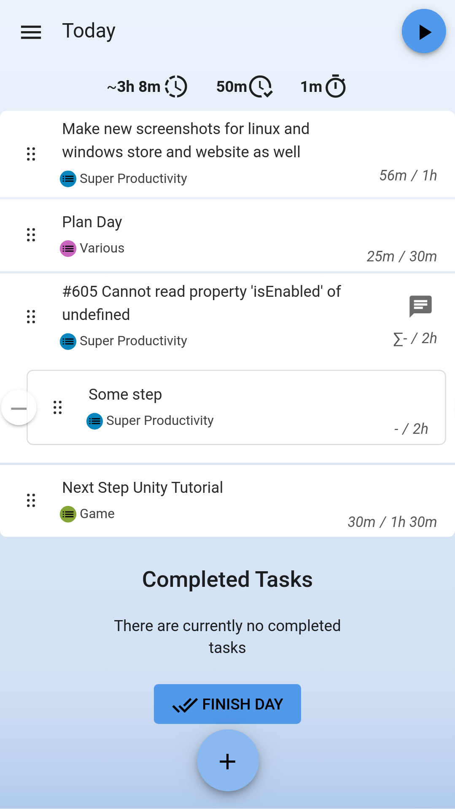
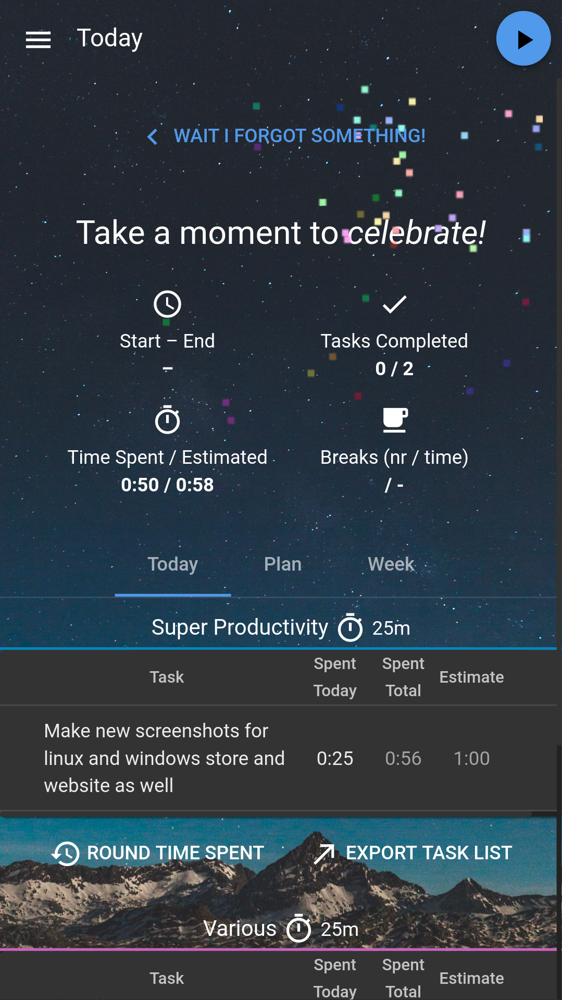
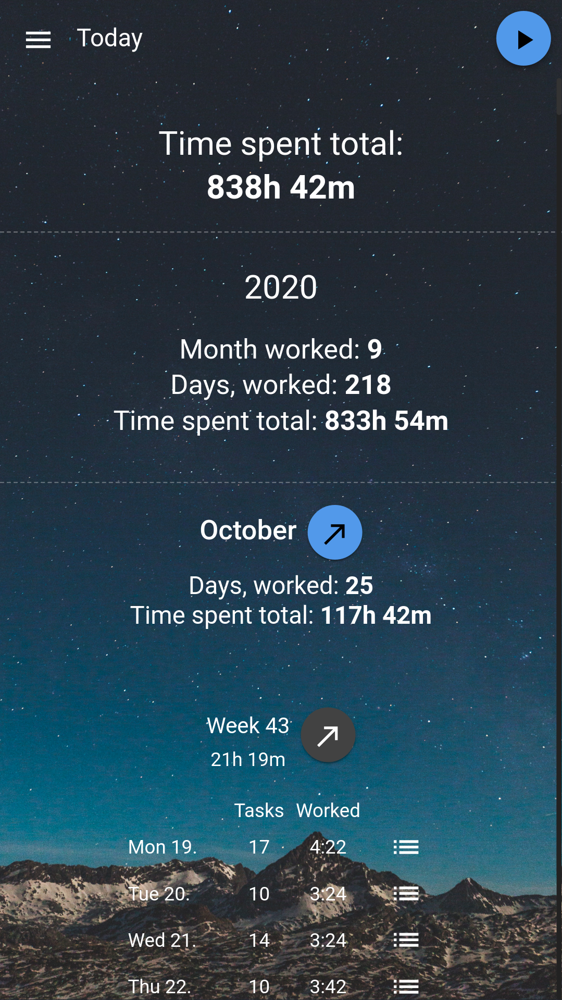
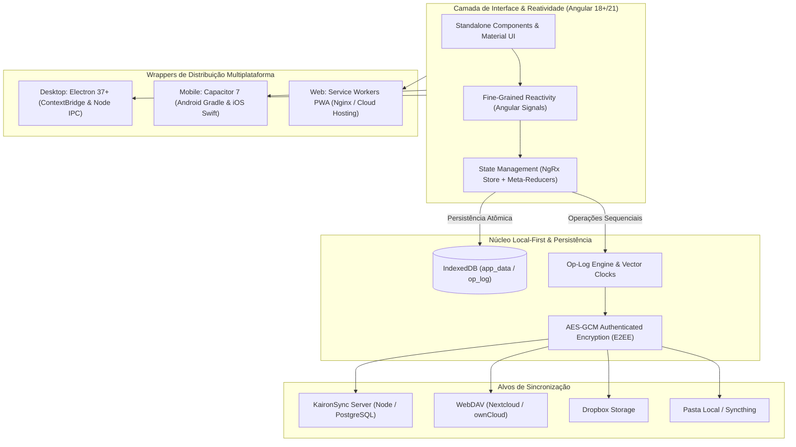
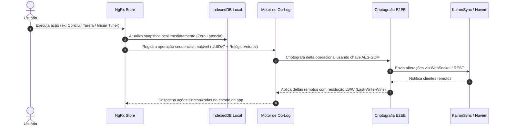

<p align="center">
  
</p>

<p align="center">
  <strong>Aplicativo profissional de alta performance para gerenciamento de tarefas, timeboxing, rastreamento de tempo e foco profundo.</strong><br/>
  Construído sob o paradigma <em>Local-First</em> com criptografia autenticada Ponta a Ponta (E2EE), zero telemetria e sincronização determinística via Relógios Vetoriais.
</p>

<p align="center">
  
  &nbsp;
  
  &nbsp;
  
  &nbsp;
  
  &nbsp;
  
  &nbsp;
  
</p>

<p align="center">
  <a href="#-principais-funcionalidades">Funcionalidades</a> •
  <a href="#-telas-e-demonstração-visual">Telas &amp; Demonstração</a> •
  <a href="#️-arquitetura-e-engenharia-do-sistema">Arquitetura</a> •
  <a href="#-como-executar-em-desenvolvimento">Como Executar</a> •
  <a href="#-empacotamento-e-build-para-produção">Builds de Produção</a> •
  <a href="#-documentação-de-auditoria-técnica">Auditorias</a> •
  <a href="#-licença-e-autoria">Licença</a>
</p>

---

## ⚡ Principais Funcionalidades

### 🎯 Gestão Inteligente de Tarefas & Timeboxing

- **Estruturação Hierárquica**: Subtarefas infinitas, múltiplos projetos, áreas de trabalho e tags coloridas com ordenação visual por arrastar e soltar (_drag-and-drop_).
- **Entrada Rápida via Sintaxe Expressiva**: Digite `#tag`, `30m` (estimativa), `@amanhã 15:00` (agendamento) ou `+Projeto` diretamente no título para auto-categorização instantânea.
- **Rastreamento de Tempo Segundo a Segundo**: Início/pausa instantâneo, monitoramento do progresso em relação às estimativas planejadas e folhas de ponto detalhadas.

### ⏱️ Hábitos, Foco Profundo e Pomodoro

- **Temporizador Pomodoro Nativo**: Ciclos configuráveis de foco, pausas curtas e intervalos longos integrados diretamente à tarefa ativa.
- **Modo Foco em Tela Cheia**: Interface imersiva sem distrações com cronômetro de alta visibilidade e controles rápidos.
- **Detecção de Ociosidade (_Idle Time_)**: Reconhece automaticamente momentos em que você se afasta do computador e oferece opções para descartar ou alocar o tempo decorrido.
- **Painel de Fechamento Diário (_Daily Summary_)**: Rotina guiada ao fim do expediente para reflexão das horas trabalhadas, exportação de apontamentos e planejamento do dia seguinte.

### 🔌 Integrações Nativas com Issue Trackers

Sincronize tarefas de forma bidirecional sem trocar de janela:

- **Jira** (Cloud & Data Center / Server) com apontamento de _Worklogs_ automático.
- **GitHub Issues** e **GitLab Issues & Merge Requests**.
- **Linear**, **Azure DevOps Boards**, **Trello**, **ClickUp**, **CalDAV / Google Calendar**, **OpenProject**, **Redmine** e **Gitea**.

### 🔒 Soberania de Dados e Sincronização Local-First

- **Seus Dados Ficam Com Você**: Zero cadastro obrigatório, zero servidores de terceiros rastreando suas tarefas e zero telemetria.
- **Sincronização Distribuída com Op-Log**: Cada modificação gera uma operação imutável com **Relógio Vetorial (Vector Clocks)** e resolução de conflitos determinística _Last-Write-Wins (LWW)_.
- **Criptografia Autenticada Ponta a Ponta (E2EE)**: Criptografa todos os payloads com **AES-GCM** antes de qualquer transmissão pela rede.
- **Suporte Multi-Destino**: Sincronize entre seus computadores e celulares usando **KaironSync**, **WebDAV** (Nextcloud / ownCloud), **Dropbox** ou pasta compartilhada local.

---

## 📸 Telas e Demonstração Visual

|                        🌙 Lista de Tarefas & Timeboxing (Dark Mode)                        |                              ☀️ Interface Dinâmica (Light Mode)                              |
| :----------------------------------------------------------------------------------------: | :------------------------------------------------------------------------------------------: |
|  |  |
|       _Planejamento diário, subtarefas e cronômetro ativo com paleta Kairon Indigo._       |         _Tema claro de alta legibilidade adaptável ao tema do sistema operacional._          |

|                           ⏱️ Resumo Diário & Planejamento de Fechamento                           |                         📊 Worklog, Métricas & Folha de Ponto                         |
| :-----------------------------------------------------------------------------------------------: | :-----------------------------------------------------------------------------------: |
|  |  |
|         _Revisão de tarefas concluídas, notas do dia e planejamento para o dia seguinte._         |    _Exportação de horas, gráficos de tempo investido por projeto e apontamentos._     |

---

## 🏛️ Arquitetura e Engenharia do Sistema

O **KaironTask** é construído como um Monorepo unificado que alimenta simultaneamente as versões **Web/PWA**, **Desktop nativa** e **Mobile nativa**.

### 📐 Visão Geral da Arquitetura em Camadas



### 🔄 Ciclo de Vida da Sincronização Local-First



---

## 🚀 Como Executar em Desenvolvimento

### Pré-requisitos

- **Node.js**: Versão 20+ ou 22 LTS
- **npm**: Versão 10+
- **Angular CLI**: Instalado globalmente (`npm i -g @angular/cli`)

### 1. Clonar o repositório e instalar dependências

```bash
git clone https://github.com/christiansousadev/kairontask.git
cd kairontask
npm install
```

### 2. Configurar variáveis de ambiente

```bash
npm run env
```

### 3. Executar na Web (Navegador)

```bash
npm run serve
# ou: ng serve
```

Acesse `http://localhost:4200` no seu navegador.

### 4. Executar no Desktop (Electron com Hot Reload)

```bash
npm start
```

### 5. Executar no Android (Capacitor)

```bash
npm run droid
```

---

## 📦 Empacotamento e Build para Produção

Todos os pacotes de produção são gerados a partir do código-fonte compilado e otimizado:

| Plataforma          | Comando de Build                | Arquivos de Saída                                                                                                |
| :------------------ | :------------------------------ | :--------------------------------------------------------------------------------------------------------------- |
| **Web / PWA**       | `npm run buildFrontend:prodWeb` | `dist/browser/` (Pronto para Vercel, Cloudflare ou Nginx)                                                        |
| **Windows Desktop** | `npm run dist:win`              | `.tmp/app-builds/KaironTask-Setup-x64.exe` (Instalador NSIS)<br/>`.tmp/app-builds/kairontask-x64.exe` (Portátil) |
| **macOS Desktop**   | `npm run dist:mac`              | `.tmp/app-builds/KaironTask-x64.dmg` / `.zip`                                                                    |
| **Linux Desktop**   | `npm run dist:linux`            | `.tmp/app-builds/KaironTask-x64.AppImage` / `.deb` / `.snap`                                                     |
| **Android (APK)**   | `npm run dist:android`          | `android/app/build/outputs/apk/fdroid/release/`                                                                  |
| **iOS (Xcode)**     | `npm run dist:ios:prod`         | `ios/App/` (Sincronizado e pronto para Archive no Xcode)                                                         |

---

## 🐳 Execução via Docker

Para rodar a versão Web localmente conteinerizada com Nginx:

```bash
docker compose up -d --build
```

A aplicação estará disponível em `http://localhost`.

---

## 🧪 Testes e Qualidade de Código

O KaironTask mantém uma esteira de testes automatizada rigorosa com mais de 8.300 testes unitários e de integração:

```bash
# Executar suíte completa de testes unitários (Karma + ChromeHeadless)
npm run test:once

# Executar validação de formatação e linter de código (TypeScript + SCSS)
npm run lint

# Validar integridade e ausência de chaves faltantes em todos os 27 idiomas
npm run int:test

# Testes E2E (End-to-End) via Playwright
npm run e2e
```

---

## 📚 Documentação de Auditoria Técnica

Para aprofundar-se na engenharia, padrões de projeto e governança do código, consulte a documentação detalhada na pasta [`auditorias/`](auditorias/):

| Caderno de Auditoria                                                                 | Foco Técnico                                                                           |
| :----------------------------------------------------------------------------------- | :------------------------------------------------------------------------------------- |
| **[`01. Arquitetura e Core`](auditorias/01_arquitetura_e_core.md)**                  | Bootstrap, NgRx Signals, Meta-Reducers, Ações Locais e Injeção de Dependências.        |
| **[`02. Persistência & Sync Op-Log`](auditorias/02_persistencia_sync_oplog.md)**     | IndexedDB, Relógios Vetoriais, Resolução de Conflitos e Criptografia AES-GCM.          |
| **[`03. Módulos & Features de Domínio`](auditorias/03_modulos_e_features.md)**       | Todas as 41 features (Tasks, Repeat, Focus Mode, Metrics e 11 Integrações).            |
| **[`04. Desktop com Electron`](auditorias/04_desktop_electron.md)**                  | Processo Main, Preload Bridge, Handlers IPC, Idle Detection e Local REST API.          |
| **[`05. Mobile com Capacitor`](auditorias/05_mobile_capacitor.md)**                  | Configurações Android (Gradle/Flavors), iOS (Xcode/Fastlane) e Plugins Nativos.        |
| **[`06. Sub-pacotes e Plugins`](auditorias/06_packages_e_plugins.md)**               | SDK `plugin-api`, esquemas Typia e microsserviço `super-sync-server`.                  |
| **[`07. Design System, UI & i18n`](auditorias/07_ui_design_system_i18n.md)**         | Variáveis CSS, temas dinâmicos, assets de ícones e catálogo de 27 idiomas.             |
| **[`08. Infraestrutura, Build & CI/CD`](auditorias/08_infra_build_cicd_testes.md)**  | Dockerfile multi-stage, workflows do GitHub Actions e matriz multi-timezone.           |
| **[`09. Mapeamento de Vestígios`](auditorias/09_varredura_vestigios_opensource.md)** | Registro de substituição de nomes legados, IDs de pacotes e checklist de conformidade. |
| **[`Índice Geral de Auditoria`](auditorias/README.md)**                              | Matriz geral de cobertura de código e índice técnico unificado.                        |

---

## 📄 Licença e Autoria
 
- **Autor e Desenvolvedor**: Christian Sousa
- **Licença**: Distribuído sob os termos da licença [MIT](LICENSE).  
Copyright (c) 2026 Christian Sousa. Todos os direitos reservados.
