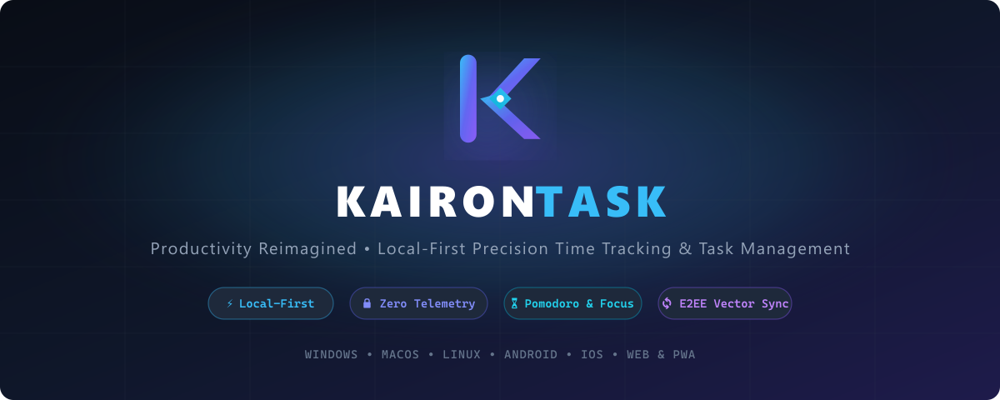
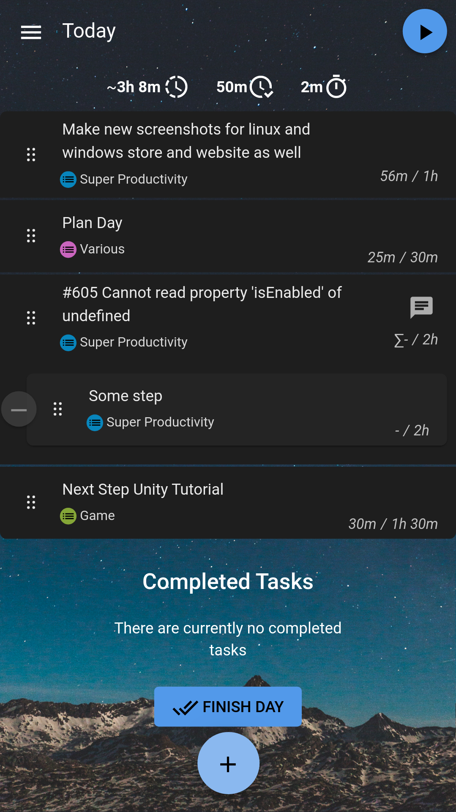
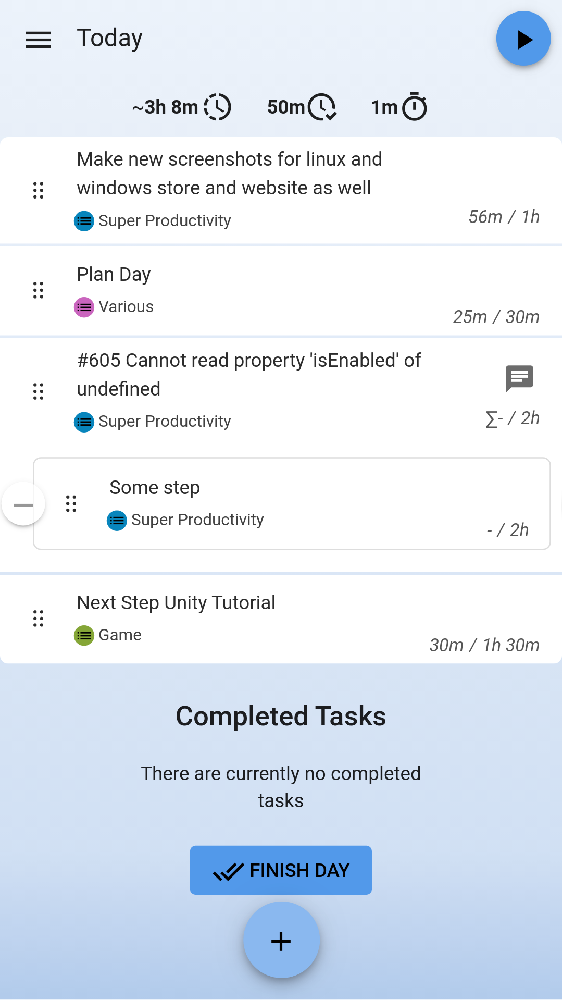
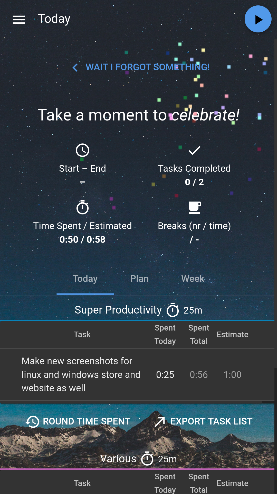
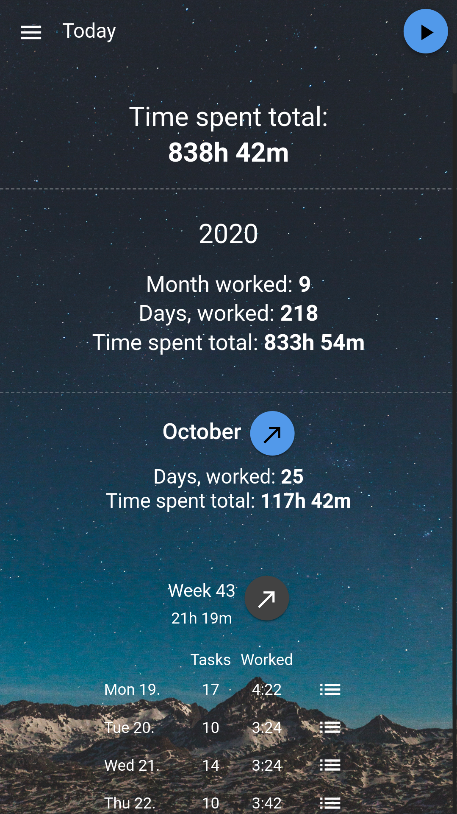
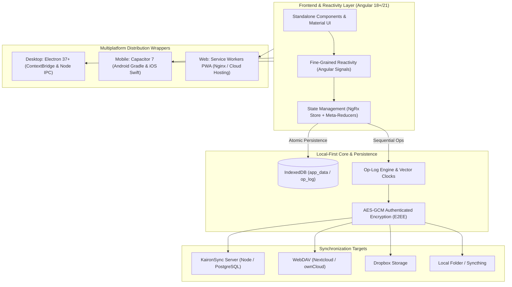
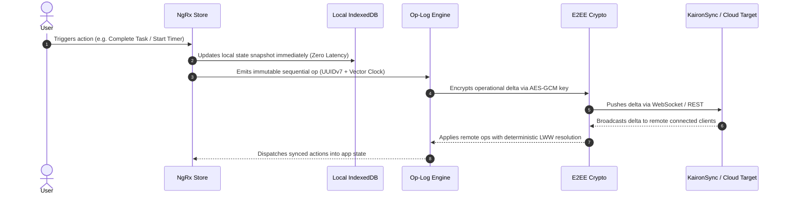

<p align="center">
  
</p>

<p align="center">
  <strong>English</strong> | <a href="README.pt-BR.md">Português (Brasil)</a>
</p>

<p align="center">
  <strong>High-performance, professional task management, timeboxing, time tracking, and deep focus application.</strong><br/>
  Engineered under the <em>Local-First</em> paradigm with authenticated End-to-End Encryption (E2EE), zero telemetry, and deterministic synchronization via Vector Clocks.
</p>

<p align="center">
  
  &nbsp;
  
  &nbsp;
  
  &nbsp;
  
  &nbsp;
  
  &nbsp;
  
  &nbsp;
  
</p>

<p align="center">
  <a href="#-key-features">Features</a> •
  <a href="#-visual-showcase--screens">Screenshots</a> •
  <a href="#-visual-identity--midnight-obsidian">Visual Identity</a> •
  <a href="#️-system-architecture--engineering">Architecture</a> •
  <a href="#-development-setup">Development</a> •
  <a href="#-packaging--production-builds">Production Builds</a> •
  <a href="#-technical-architecture-documentation">Architecture Docs</a> •
  <a href="#-license--authorship">License</a>
</p>

---

## ⚡ Key Features

### 🎯 Smart Task Management & Timeboxing

- **Hierarchical Structuring**: Deep subtasks, multiple projects, workspaces, and color-coded tags with intuitive drag-and-drop organization.
- **Expressive Quick-Add Syntax**: Type `#tag`, `30m` (time estimate), `@tomorrow 15:00` (scheduled reminder), or `+Project` directly in the title input for instant auto-categorization.
- **Precision Time Tracking**: Instant start/pause timer, real-time progress vs. estimated duration, and comprehensive timesheet reporting.

### ⏱️ Habits, Deep Focus & Pomodoro

- **Built-in Pomodoro Engine**: Fully customizable focus blocks, short rests, and long pauses tied directly to your active task.
- **Distraction-Free Focus Mode**: Fullscreen immersive view with high-visibility timer, progress visualization, and quick controls.
- **Idle Time Detection**: Automatically senses when you step away from your workstation, offering immediate options to allocate or discard elapsed time.
- **Daily Summary Workflow**: End-of-day guided review to reflect on completed achievements, inspect logged hours, and plan the upcoming day.

### 🔌 Native Issue Tracker Integrations

Two-way synchronization with leading issue tracking and developer platforms without tab switching:

- **Jira** (Cloud & Data Center / Server) with automatic worklog submission.
- **GitHub Issues** and **GitLab Issues & Merge Requests**.
- **Linear**, **Azure DevOps Boards**, **Trello**, **ClickUp**, **CalDAV / Google Calendar**, **OpenProject**, **Redmine**, and **Gitea**.

### 🔒 Data Sovereignty & Local-First Synchronization

- **Your Data Remains Yours**: Zero required account creation, zero third-party behavioral tracking, and zero telemetry.
- **Distributed Op-Log Engine**: Every state mutation produces an immutable delta stamped with a **Vector Clock** and resolved deterministically using **Last-Write-Wins (LWW)**.
- **Authenticated End-to-End Encryption (E2EE)**: Payloads are client-side encrypted using **AES-256-GCM** prior to any network transit.
- **Multi-Target Sync Support**: Synchronize seamlessly across desktops and mobile devices via **KaironSync**, **WebDAV** (Nextcloud / ownCloud), **Dropbox**, or a shared local filesystem directory.

---

## 📸 Visual Showcase & Screens

|                           🌙 Task List & Timeboxing (Dark Mode)                            |                          ☀️ Adaptive Dynamic Interface (Light Mode)                          |
| :----------------------------------------------------------------------------------------: | :------------------------------------------------------------------------------------------: |
|  |  |
|        _Daily planning, nested subtasks, and active stopwatch timer in dark theme._        |         _High-contrast, clean light theme adapting automatically to OS appearance._          |

|                                ⏱️ Daily Summary & Workday Wrap-Up                                 |                         📊 Worklog, Time Metrics & Timesheets                         |
| :-----------------------------------------------------------------------------------------------: | :-----------------------------------------------------------------------------------: |
|  |  |
|             _Completed tasks review, workday retrospective, and next-day scheduling._             |   _Timesheet exports, project time allocation breakdown, and productivity charts._    |

---

## 🎨 Visual Identity — Midnight Obsidian

KaironTask features an original design system crafted for focused software engineers and power users: deep **obsidian** surfaces with subtle slate undertones, **vibrant violet** as primary accent, and **electric cyan** highlights.

| Design Token               | Color                 | Purpose                                                 |
| :------------------------- | :-------------------- | :------------------------------------------------------ |
| `--bg` (dark)              | `#0B0D12`             | Root application background                             |
| `--sidenav-bg` (dark)      | `#0E1117`             | Navigation sidebar background                           |
| `--dark2` / `--card-bg`    | `#11141B` / `#161A23` | Elevation surfaces, task cards, and interactive modals  |
| `--brand-violet` / primary | `#7C3AED`             | Primary CTA buttons, active sidebar item, task focus    |
| `--brand-cyan` / highlight | `#22D3EE`             | Quick-add focus ring, active task glow, progress meters |
| `--bg` (light)             | `#F5F6FA`             | Light mode canvas background                            |

Design Highlights:

- **Splash Screen**: Gradient ring (violet → cyan) with a subtle pulse animation respecting `prefers-reduced-motion`.
- **Task Cards**: Refined 8px rounded corners, translucent borders, and deep soft shadows calibrated for dark OLED displays.
- **Quick-Add**: Electric cyan focus glow with discrete tag pill badges.
- **Sidebar**: Clean brand mark with subtle _by Christian Sousa_ signature.
- **Platform Alignment**: Matching native color palettes across Android status/navigation bars, iOS safe areas, Electron title bars, and PWA manifests.

All design tokens are maintained in [`src/styles/_css-variables.scss`](src/styles/_css-variables.scss). For guidelines, see [`docs/styling-guide.md`](docs/styling-guide.md). Default project/tag themes are defined in [`work-context.const.ts`](src/app/features/work-context/work-context.const.ts).

---

## 🏛️ System Architecture & Engineering

**KaironTask** is structured as a unified monorepo delivering concurrent builds for **Web/PWA**, **Native Desktop**, and **Native Mobile**.

### 📐 Layered Architecture Overview



### 🔄 Local-First Sync Lifecycle



---

## 🚀 Development Setup

### Prerequisites

- **Node.js**: Version 20+ or 22 LTS
- **npm**: Version 10+
- **Angular CLI**: Globally installed (`npm i -g @angular/cli`)

### 1. Clone Repository & Install Dependencies

```bash
git clone https://github.com/christiansousadev/kairontask.git
cd kairontask
npm install
```

### 2. Configure Environment

```bash
npm run env
```

### 3. Run on Web (Browser)

```bash
npm run serve
# or: ng serve
```

Open `http://localhost:4200` in your web browser.

### 4. Run on Desktop (Electron with Hot Reload)

```bash
npm start
```

### 5. Run on Android (Capacitor)

```bash
npm run droid
```

---

## 📦 Packaging & Production Builds

All production deliverables are generated from optimized, ahead-of-time compiled sources:

| Target Platform     | Build Command                   | Output Artifacts                                                                                                |
| :------------------ | :------------------------------ | :-------------------------------------------------------------------------------------------------------------- |
| **Web / PWA**       | `npm run buildFrontend:prodWeb` | `dist/browser/` (Ready for Vercel, Cloudflare Pages, or Nginx)                                                  |
| **Windows Desktop** | `npm run dist:win`              | `.tmp/app-builds/KaironTask-Setup-x64.exe` (NSIS Installer)<br/>`.tmp/app-builds/kairontask-x64.exe` (Portable) |
| **macOS Desktop**   | `npm run dist:mac`              | `.tmp/app-builds/KaironTask-x64.dmg` / `.zip`                                                                   |
| **Linux Desktop**   | `npm run dist:linux`            | `.tmp/app-builds/KaironTask-x64.AppImage` / `.deb` / `.snap`                                                    |
| **Android (APK)**   | `npm run dist:android`          | `android/app/build/outputs/apk/fdroid/release/`                                                                 |
| **iOS (Xcode)**     | `npm run dist:ios:prod`         | `ios/App/` (Synced Xcode workspace ready for Archive)                                                           |

---

## 🐳 Docker Deployment

To run the containerized Web application locally with Nginx:

```bash
docker compose up -d --build
```

The application will be accessible at `http://localhost`.

---

## 🧪 Testing & Code Quality

KaironTask enforces a continuous quality pipeline with over 8,300 unit and integration tests:

```bash
# Run full unit & integration test suite (Karma + ChromeHeadless)
npm run test:once

# Run code format and static lint checks (TypeScript + SCSS)
npm run lint

# Validate translation catalog integrity across all 27 languages
npm run int:test

# Run End-to-End (E2E) automated browser tests via Playwright
npm run e2e
```

---

## 📚 Technical Architecture Documentation

For deep dives into design patterns, state machines, and platform subsystems, refer to the unified documentation in [`docs/architecture/`](docs/architecture/):

| Technical Specification                                                                  | Engineering Focus                                                                 |
| :--------------------------------------------------------------------------------------- | :-------------------------------------------------------------------------------- |
| **[`01. Core & State Management`](docs/architecture/01-core-and-state.md)**              | Bootstrap, NgRx Signals, Meta-Reducers, Local Actions, and Dependency Injection.  |
| **[`02. Persistence & Op-Log Sync`](docs/architecture/02-persistence-and-sync.md)**      | IndexedDB, Vector Clocks, Conflict Resolution, and AES-GCM Encryption.            |
| **[`03. Domain Modules & Features`](docs/architecture/03-modules-and-features.md)**      | All 41 domain features (Tasks, Repeat, Focus Mode, Metrics, and 11 Integrations). |
| **[`04. Desktop with Electron`](docs/architecture/04-desktop-electron.md)**              | Main Process, Preload Bridge, IPC Handlers, Idle Detection, and Local REST API.   |
| **[`05. Mobile with Capacitor`](docs/architecture/05-mobile-capacitor.md)**              | Android Gradle flavor setups, iOS Xcode/Fastlane pipelines, and native plugins.   |
| **[`06. Sub-packages & Plugins`](docs/architecture/06-packages-and-plugins.md)**         | `plugin-api` SDK, Typia schema definitions, and `super-sync-server` service.      |
| **[`07. Design System, UI & i18n`](docs/architecture/07-design-system-and-i18n.md)**     | CSS Custom Properties, dynamic theming, icon assets, and 27-language catalog.     |
| **[`08. Infrastructure, Build & Tests`](docs/architecture/08-infra-build-and-tests.md)** | Multi-stage Dockerfile, multi-timezone Karma matrix, and automated test runners.  |
| **[`System Architecture Index`](docs/architecture/README.md)**                           | High-level system topology, component mapping, and monorepo guidelines.           |

---

## 📄 License & Authorship

- **Author & Maintainer**: Christian Sousa
- **Website**: [christiansousa.dev](https://christiansousa.dev)
- **Web App**: [kairontask.christiansousa.dev](https://kairontask.christiansousa.dev)
- **Contact / Inquiries**: [contato@christiansousa.dev](mailto:contato@christiansousa.dev)
- **Repository**: [github.com/christiansousadev/kairontask](https://github.com/christiansousadev/kairontask)
- **License**: Released under the terms of the [MIT License](LICENSE).

Copyright (c) 2026 Christian Sousa. Original MIT notice (`Copyright (c) 2018 Johannes Millan`) is preserved in the [LICENSE](LICENSE) file as required by the MIT License.
