<p align="center">
  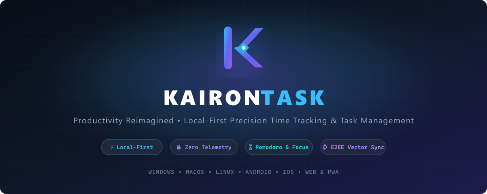
</p>

<p align="center">
  <a href="README.md">English</a> | <strong>Português (Brasil)</strong>
</p>

<p align="center">
  <strong>Aplicativo profissional de alta performance para gerenciamento de tarefas, timeboxing, rastreamento de tempo e foco profundo.</strong><br/>
  Construído sob o paradigma <em>Local-First</em> com criptografia autenticada Ponta a Ponta (E2EE), zero telemetria e sincronização determinística via Relógios Vetoriais.
</p>

<p align="center">
  
  &nbsp;
  
  &nbsp;
  
  &nbsp;
  
  &nbsp;
  
  &nbsp;
  
  &nbsp;
  
</p>

<p align="center">
  <a href="#-principais-funcionalidades">Funcionalidades</a> •
  <a href="#-telas-e-demonstração-visual">Telas &amp; Demonstração</a> •
  <a href="#-identidade-visual--midnight-obsidian">Identidade Visual</a> •
  <a href="#️-arquitetura-e-engenharia-do-sistema">Arquitetura</a> •
  <a href="#-como-executar-em-desenvolvimento">Como Executar</a> •
  <a href="#-empacotamento-e-build-para-produção">Builds de Produção</a> •
  <a href="#-documentação-técnica-da-arquitetura">Documentação Técnica</a> •
  <a href="#-licença-e-autoria">Licença</a>
</p>

---

## ⚡ Principais Funcionalidades

### 🎯 Gestão Inteligente de Tarefas & Timeboxing

- **Estruturação Hierárquica**: Subtarefas infinitas, múltiplos projetos, áreas de trabalho e tags coloridas com ordenação visual por arrastar e soltar (_drag-and-drop_).
- **Entrada Rápida via Sintaxe Expressiva**: Digite `#tag`, `30m` (estimativa), `@amanhã 15:00` (agendamento) ou `+Projeto` diretamente no título para auto-categorização instantânea.
- **Rastreamento de Tempo Segundo a Segundo**: Início/pausa instantâneo, monitoramento do progresso em relação às estimativas planejadas e folhas de ponto detalhadas.

### ⏱️ Hábitos, Foco Profundo e Pomodoro

- **Temporizador Pomodoro Nativo**: Ciclos configuráveis de foco, pausas curtas e intervalos longos integrados diretamente à tarefa ativa.
- **Modo Foco em Tela Cheia**: Interface imersiva sem distrações com cronômetro de alta visibilidade e controles rápidos.
- **Detecção de Ociosidade (_Idle Time_)**: Reconhece automaticamente momentos em que você se afasta do computador e oferece opções para descartar ou alocar o tempo decorrido.
- **Painel de Fechamento Diário (_Daily Summary_)**: Rotina guiada ao fim do expediente para reflexão das horas trabalhadas, exportação de apontamentos e planejamento do dia seguinte.

### 🔌 Integrações Nativas com Issue Trackers

Sincronize tarefas de forma bidirecional sem trocar de janela:

- **Jira** (Cloud & Data Center / Server) com apontamento de _Worklogs_ automático.
- **GitHub Issues** e **GitLab Issues & Merge Requests**.
- **Linear**, **Azure DevOps Boards**, **Trello**, **ClickUp**, **CalDAV / Google Calendar**, **OpenProject**, **Redmine** e **Gitea**.

### 🔒 Soberania de Dados e Sincronização Local-First

- **Seus Dados Ficam Com Você**: Zero cadastro obrigatório, zero servidores de terceiros rastreando suas tarefas e zero telemetria.
- **Sincronização Distribuída com Op-Log**: Cada modificação gera uma operação imutável com **Relógio Vetorial (Vector Clocks)** e resolução de conflitos determinística _Last-Write-Wins (LWW)_.
- **Criptografia Autenticada Ponta a Ponta (E2EE)**: Criptografa todos os payloads com **AES-GCM** antes de qualquer transmissão pela rede.
- **Suporte Multi-Destino**: Sincronize entre seus computadores e celulares usando **KaironSync**, **WebDAV** (Nextcloud / ownCloud), **Dropbox** ou pasta compartilhada local.

---

## 📸 Tour Visual do Produto

Veja como o KaironTask conduz seu fluxo de trabalho — da captura rápida pelo teclado ao foco profundo, planejamento semanal e fechamento do dia.

### 1. Workspace Hoje, Timeboxing e Temas Adaptativos

A visualização **Hoje** centraliza sua rotina: uma barra lateral retrátil organiza **Listas Inteligentes**, **Projetos** (`KaironTask Core`, `Design System`, `Sync Engine`, `Mobile App`) e **Tags**, enquanto a barra superior em pílula acompanha capacidade estimada vs. restante em tempo real (`~3h 11m` / `3h 20m`). A tarefa ativa recebe destaque em ciano elétrico com cronômetro ao vivo, subtarefas expansíveis e um **painel lateral em Markdown** com checklists interativos.

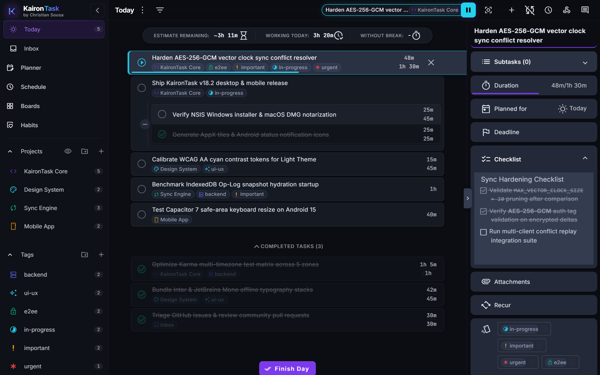

_Modo Escuro Midnight Obsidian com navegação por projetos, barra de métricas em pílula, rastreio ativo em ciano, subtarefas e painel Markdown._

<details>
<summary>☀️ Visualizar Modo Claro Adaptativo de Alto Contraste</summary>

<br/>

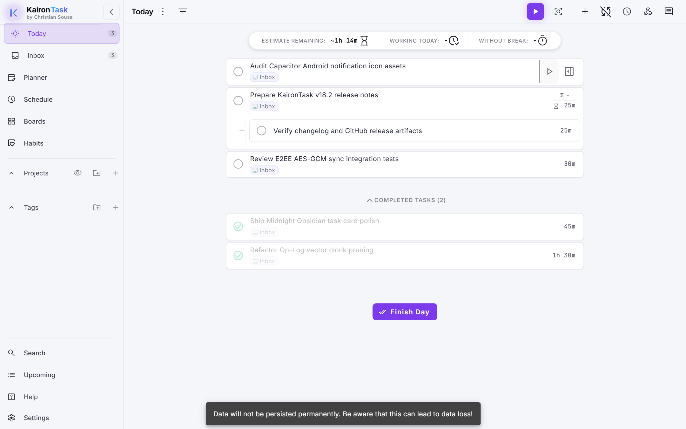

_Modo Claro limpo e de alto contraste, com bordas estruturais nítidas de `1px` e realce ciano calibrado (WCAG AA)._

</details>

### 2. Foco Profundo e Motor Pomodoro

Pressione `F` (ou clique no botão de foco no cabeçalho) para entrar no **Modo Foco** — uma tela limpa sobre gradiente radial Midnight Obsidian. Alterne entre modos **Countdown**, **Pomodoro** (ciclos configuráveis de `25m` / `5m` / `15m`) e **Flowtime** mantendo apenas a tarefa em andamento visível.

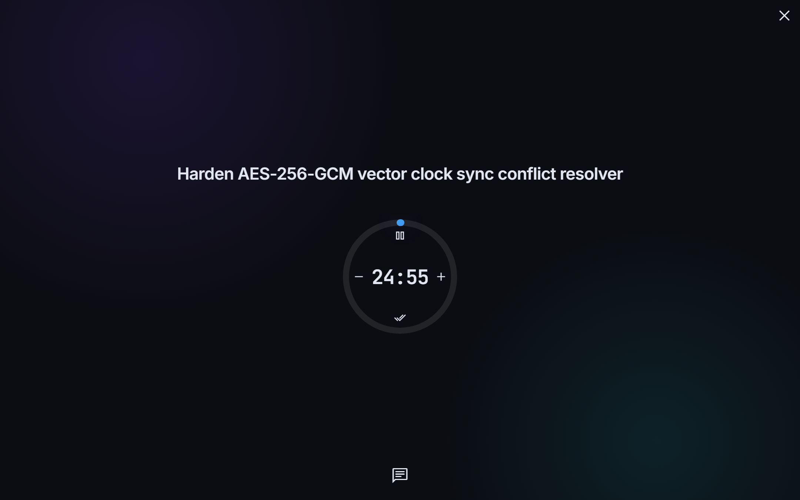

_HUD do Modo Foco em tela cheia com anel regressivo ativo (`24:55`) e zero distrações laterais._

### 3. Planejador Semanal, Cronograma Timeblocked e Quadros Kanban

Organize sua semana inteira e distribua blocos concretos de execução ao longo da jornada:

|                                 📅 Planejador Semanal                                 |                             ⏱️ Cronograma (Timeline Schedule)                              |
| :-----------------------------------------------------------------------------------: | :----------------------------------------------------------------------------------------: |
| 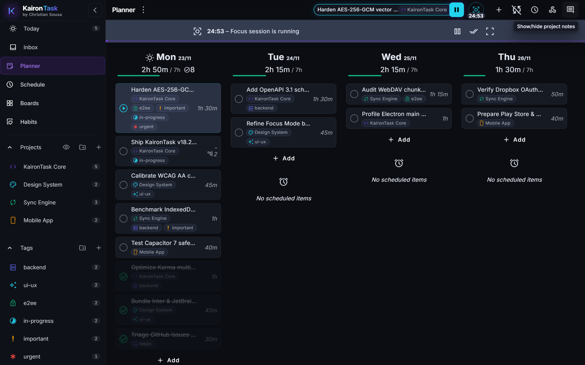 | 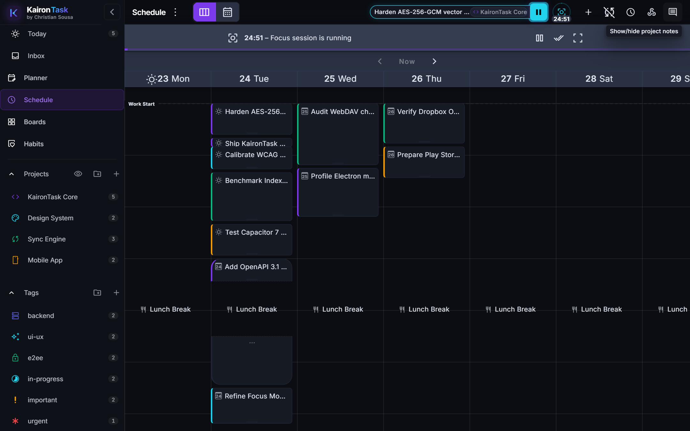 |
|    _Colunas multi-dia (`Seg`–`Qui`) com carga horária diária e arrastar-e-soltar._    |     _Timeblocking automático com blocos coloridos por projeto e intervalos de pausa._      |

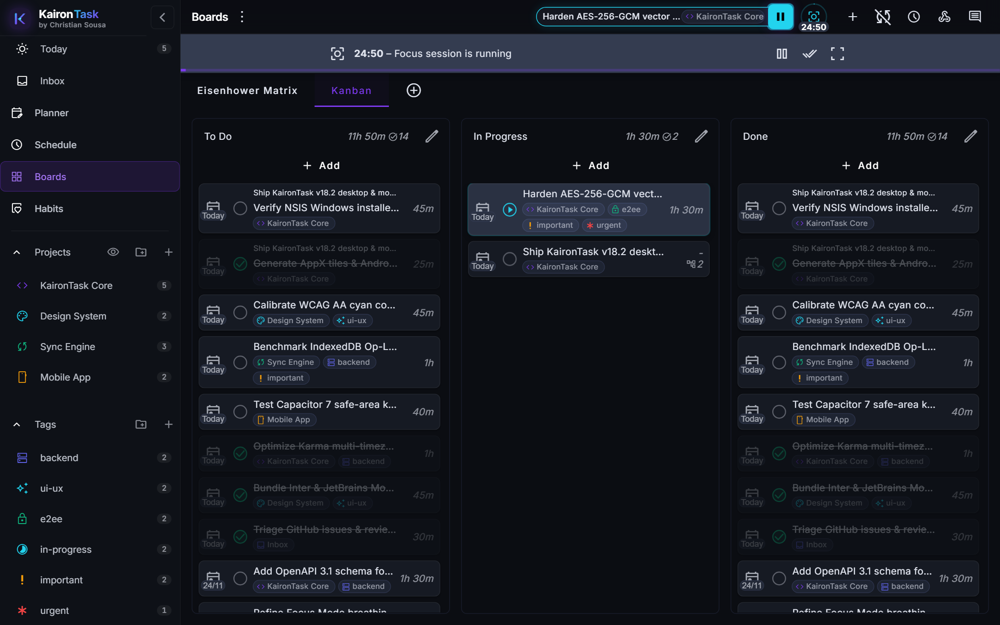

_Quadros **Kanban** customizáveis (`To Do`, `In Progress`, `Done`) e abas integradas da **Matriz de Eisenhower** para triagem visual e controle de WIP._

### 4. Resumo Diário, Worklog e Folha de Ponto

Encerre o expediente com clareza através de cards KPI (`09:05 - 17:17`, tarefas concluídas, tempo trabalhado), tabelas agrupadas por projeto e um **Worklog** histórico com totais semanais e diários.

|                                  🌙 Resumo Diário & Retrospectiva                                  |                              📊 Worklog & Folha de Ponto                               |
| :------------------------------------------------------------------------------------------------: | :------------------------------------------------------------------------------------: |
| 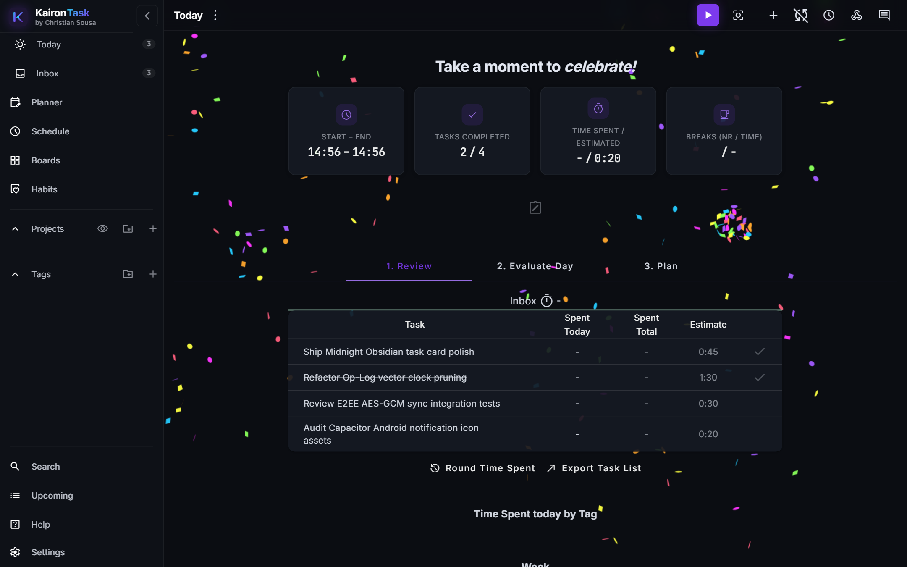  | 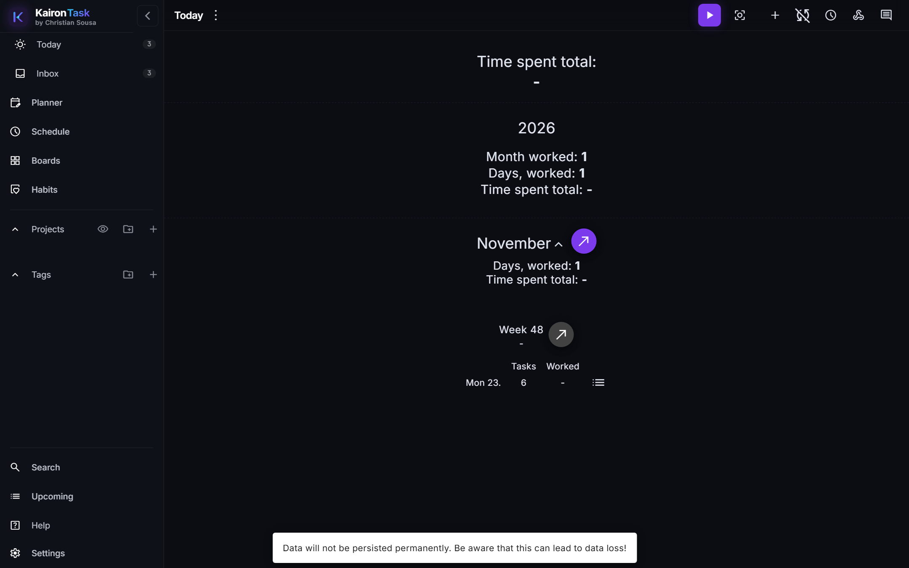  |
| _Fechamento do dia com janela de trabalho (`09:05 - 17:17`), KPIs e revisão agrupada por projeto._ | _Histórico semanal e diário (`26h 55m` em 8 dias) com acesso rápido à folha de ponto._ |

---

## ⌨️ Sintaxe Rápida & Atalhos Padrão

Crie, categorize, estime e agende tarefas em uma única linha usando a barra de adição rápida (`Shift+A`):

```text
Audit OAuth2 token refresh flow +Sync Engine #e2ee #backend t45m/1h30m @tomorrow 10:00
```

| Token / Atalho                | Comportamento                                                            |
| :---------------------------- | :----------------------------------------------------------------------- |
| `+Projeto`                    | Vincula a tarefa a um projeto existente (`+Sync Engine`)                 |
| `#tag`                        | Associa ou cria tags automaticamente (`#backend`, `#ui-ux`)              |
| `30m` / `1h 30m` / `t45m/1h`  | Define estimativa ou razão `tempoGasto/estimativa`                       |
| `@tomorrow 10:00` / `@Friday` | Interpreta datas e lembretes em linguagem natural (`chrono-node`)        |
| `Shift+A` / `Y` / `D`         | Nova tarefa rápida / Iniciar-pausar timer / Concluir tarefa              |
| `A` / `T` / `S` / `I`         | Adicionar subtarefa / Estimar tempo / Agendar / Abrir painel Markdown    |
| `F` / `W` / `Shift+T` / `?`   | Modo Foco / Visão Hoje / Cronograma Timeline / Ajuda completa de atalhos |

---

## 🎨 Identidade Visual — Midnight Obsidian

O KaironTask adota um design system autoral, com estética de produto SaaS premium: superfícies em **obsidiana** com leve tom ardósia, **violeta** como cor primária e **ciano elétrico** como destaque.

| Token                       | Cor                   | Uso                                                     |
| :-------------------------- | :-------------------- | :------------------------------------------------------ |
| `--bg` (escuro)             | `#0B0D12`             | Fundo da aplicação                                      |
| `--sidenav-bg` (escuro)     | `#0E1117`             | Barra lateral                                           |
| `--dark2` / `--card-bg`     | `#11141B` / `#161A23` | Superfícies, cartões de tarefa e painéis                |
| `--brand-violet` / primária | `#7C3AED`             | Ações principais, item ativo do menu, seleção de tarefa |
| `--brand-cyan` / destaque   | `#22D3EE`             | Foco da entrada rápida, tarefa em andamento, realces    |
| `--bg` (claro)              | `#F5F6FA`             | Fundo do tema claro                                     |

Destaques do redesign:

- **Splash screen** com anel em gradiente violeta → ciano, brilho pulsante suave e respeito a `prefers-reduced-motion`.
- **Tipografia autoral offline**: `Inter` para interface e títulos combinada com `JetBrains Mono` (`tabular-nums`) em cronômetros, badges e métricas.
- **Cartões de tarefa & Barra de status**: bordas nítidas de `1px`, faixa lateral ciano na tarefa ativa, guias verticais em subtarefas, checkmark semântico verde e barra de métricas em pílula.
- **Focus Mode & Daily Summary**: fundo atmosférico radial, anel de progresso gradiente violeta→ciano e cards KPI em grid no fechamento do dia.
- **Barra lateral & Header**: header translúcido com botão Play _squircle_, pílula de tarefa ativa, indicador lateral em gradiente e assinatura _by Christian Sousa_.
- Cores nativas alinhadas em todas as plataformas: barra de status/navegação Android, área segura iOS, title bar do Electron e manifesto PWA.

Todos os tokens vivem em [`src/styles/_css-variables.scss`](src/styles/_css-variables.scss); as regras de estilo e especificações do Design System estão em [`docs/architecture/07-design-system-and-i18n.md`](docs/architecture/07-design-system-and-i18n.md). O tema padrão de projetos e tags novos é definido em [`work-context.const.ts`](src/app/features/work-context/work-context.const.ts).

---

## 🏛️ Arquitetura e Engenharia do Sistema

O **KaironTask** é construído como um Monorepo unificado que alimenta simultaneamente as versões **Web/PWA**, **Desktop nativa** e **Mobile nativa**.

### 📐 Visão Geral da Arquitetura em Camadas

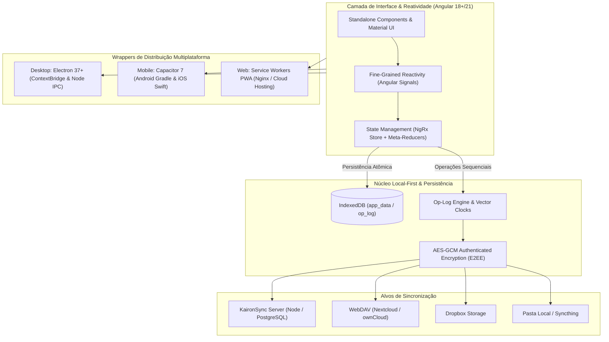

### 🔄 Ciclo de Vida da Sincronização Local-First

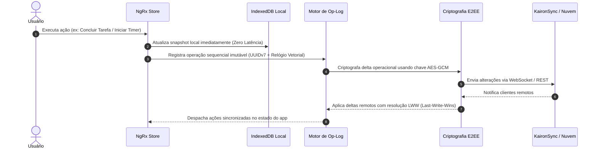

---

## 🚀 Como Executar em Desenvolvimento

### Pré-requisitos

- **Node.js**: Versão 20+ ou 22 LTS
- **npm**: Versão 10+
- **Angular CLI**: Instalado globalmente (`npm i -g @angular/cli`)

### 1. Clonar o repositório e instalar dependências

```bash
git clone https://github.com/christiansousadev/kairontask.git
cd kairontask
npm install
```

### 2. Configurar variáveis de ambiente

```bash
npm run env
```

### 3. Executar na Web (Navegador)

```bash
npm run serve
# ou: ng serve
```

Acesse `http://localhost:4200` no seu navegador.

### 4. Executar no Desktop (Electron com Hot Reload)

```bash
npm start
```

### 5. Executar no Android (Capacitor)

```bash
npm run droid
```

---

## 📦 Empacotamento e Build para Produção

Todos os pacotes de produção são gerados a partir do código-fonte compilado e otimizado:

| Plataforma          | Comando de Build                | Arquivos de Saída                                                                                                |
| :------------------ | :------------------------------ | :--------------------------------------------------------------------------------------------------------------- |
| **Web / PWA**       | `npm run buildFrontend:prodWeb` | `dist/browser/` (Pronto para Vercel, Cloudflare ou Nginx)                                                        |
| **Windows Desktop** | `npm run dist:win`              | `.tmp/app-builds/KaironTask-Setup-x64.exe` (Instalador NSIS)<br/>`.tmp/app-builds/kairontask-x64.exe` (Portátil) |
| **macOS Desktop**   | `npm run dist:mac`              | `.tmp/app-builds/KaironTask-x64.dmg` / `.zip`                                                                    |
| **Linux Desktop**   | `npm run dist:linux`            | `.tmp/app-builds/KaironTask-x64.AppImage` / `.deb` / `.snap`                                                     |
| **Android (APK)**   | `npm run dist:android`          | `android/app/build/outputs/apk/fdroid/release/`                                                                  |
| **iOS (Xcode)**     | `npm run dist:ios:prod`         | `ios/App/` (Sincronizado e pronto para Archive no Xcode)                                                         |

---

## 🐳 Execução via Docker

Para rodar a versão Web localmente conteinerizada com Nginx:

```bash
docker compose up -d --build
```

A aplicação estará disponível em `http://localhost`.

---

## 🧪 Testes e Qualidade de Código

O KaironTask mantém uma esteira de testes automatizada rigorosa com mais de 8.300 testes unitários e de integração:

```bash
# Executar suíte completa de testes unitários (Karma + ChromeHeadless)
npm run test:once

# Executar validação de formatação e linter de código (TypeScript + SCSS)
npm run lint

# Validar integridade e ausência de chaves faltantes em todos os 27 idiomas
npm run int:test

# Testes E2E (End-to-End) via Playwright
npm run e2e
```

---

## 📚 Documentação Técnica da Arquitetura

Para uma análise detalhada dos padrões de engenharia, ciclo de vida do estado e governança do código, consulte a documentação técnica unificada em [`docs/architecture/`](docs/architecture/):

| Especificação Técnica                                                                     | Foco de Engenharia                                                              |
| :---------------------------------------------------------------------------------------- | :------------------------------------------------------------------------------ |
| **[`01. Core & Gerenciamento de Estado`](docs/architecture/01-core-and-state.md)**        | Bootstrap, NgRx Signals, Meta-Reducers, Ações Locais e Injeção de Dependências. |
| **[`02. Persistência & Sync Op-Log`](docs/architecture/02-persistence-and-sync.md)**      | IndexedDB, Relógios Vetoriais, Resolução de Conflitos e Criptografia AES-GCM.   |
| **[`03. Módulos & Features de Domínio`](docs/architecture/03-modules-and-features.md)**   | Todas as 41 features (Tasks, Repeat, Focus Mode, Metrics e 11 Integrações).     |
| **[`04. Desktop com Electron`](docs/architecture/04-desktop-electron.md)**                | Processo Main, Preload Bridge, Handlers IPC, Idle Detection e Local REST API.   |
| **[`05. Mobile com Capacitor`](docs/architecture/05-mobile-capacitor.md)**                | Configurações Android (Gradle/Flavors), iOS (Xcode/Fastlane) e Plugins Nativos. |
| **[`06. Sub-pacotes e Plugins`](docs/architecture/06-packages-and-plugins.md)**           | SDK `plugin-api`, esquemas Typia e microsserviço `super-sync-server`.           |
| **[`07. Design System, UI & i18n`](docs/architecture/07-design-system-and-i18n.md)**      | Variáveis CSS, temas dinâmicos, assets de ícones e catálogo de 27 idiomas.      |
| **[`08. Infraestrutura, Build & Testes`](docs/architecture/08-infra-build-and-tests.md)** | Dockerfile multi-stage, matriz multi-timezone e automação de testes.            |
| **[`Índice Geral de Arquitetura`](docs/architecture/README.md)**                          | Mapa conceitual, diagrama de componentes e especificações técnicas unificadas.  |

---

## 📄 Licença e Autoria

- **Autor e Mantenedor**: Christian Sousa
- **Website**: [christiansousa.dev](https://christiansousa.dev)
- **App Web**: [kairontask.christiansousa.dev](https://kairontask.christiansousa.dev)
- **Landing Page do Produto**: [`landing/`](landing/) (Site estático multi-idioma Dark/Light)
- **Contato / Suporte**: [contato@christiansousa.dev](mailto:contato@christiansousa.dev)
- **Repositório**: [github.com/christiansousadev/kairontask](https://github.com/christiansousadev/kairontask)
- **Licença**: Distribuído sob os termos da licença [MIT](LICENSE).

Copyright (c) 2026 Christian Sousa. O aviso de copyright original (`Copyright (c) 2018 Johannes Millan`) é preservado no arquivo [LICENSE](LICENSE), conforme exigido pela licença MIT.
